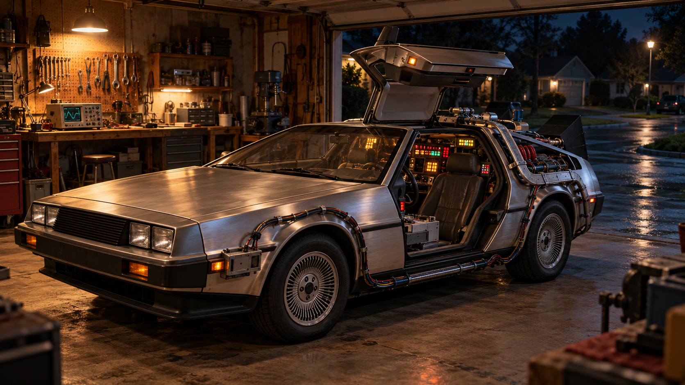

# Animation18 — candidate recommendation

2026-11-05. The user asks what to develop after backing up the complete scene16/17 drafts. This is a recommendation from existing art, not an assigned release, approved thumbnail, new render or CTR result. Catalog17 remains the last selected numbered scene.

## Recommended: Back Before Dawn

Use H1, **The Time Machine at Midnight**, the Back to the Future inspired workshop. The current clean plate gives the car most of the frame, with a clear raised-door silhouette, warm practical workshop light and a cool wet street outside. That is a useful visual change after the city and Gate Camp. Its single large subject is my strongest recognition hypothesis among this shortlist; audience performance still needs testing.

[Source brief and inspection concerns](../../brainstorm/2026-10-27-retro-worlds/h1-workshop/README.md) · [Existing thumbnail study](../../brainstorm/2026-10-27-retro-worlds/h1-workshop/thumbnail-v1.jpg). Preserve the clean plate separately: the thumbnail changes light/colour and is not a replacement animation source.

The official [1985 production notes](https://www.backtothefuture.com/movies/production-notes-1985), checked2026-11-05, describe the gull-wing DeLorean and equipment assembled to look homemade. That supports retaining ordinary tools and tactile hardware in this interpretation. It does not establish that our generated car or garage is screen-accurate.

## First animation pass

| Layer | Visible action and constraint |
|---|---|
| Exterior rain | Fine rain beneath the streetlamp, with distinct near/far fall speeds; stop it at the garage opening. |
| Wet street | Small impact ripples and moving reflection breakup confined to exterior water, with fixed kerb/road/tree geometry. |
| Time-circuit/status displays | A few independent held equipment states in the existing cabin displays. Keep the devices and their original colours; avoid a constant countdown or synchronized blink. |
| Workbench oscilloscope | Animate a restrained trace within the photographed screen perspective. Preserve the instrument casing and original physical knobs. |
| Attached cabin light | Match selected equipment changes to restrained spill on nearby seat, door recess and metal edges. Do not wash the entire car blue. |
| Work-lamp behaviour | Mostly stable light with one brief uneven dip in the review minute; include white emitter core and the corresponding bench/bonnet reflection. Preserve brushed-metal texture. |
| Exterior wind | Optional gentle treetop response only after a clean revealed background and branch/sky geometry proof. |
| Rare passing light | An optional distant vehicle headlight wash on the street; requires a traced physical route and source-facing receivers before inclusion. |

Keep the parked car, open door, camera, tools and workshop structure fixed in the initial draft. Rain, screens and their light responses should provide continuous visible life. Repeated departures, door cycles, electrical arcs and time-travel bursts would compete with the stay-here mood; they are outside this first proposal.

Start with an8–12second combined720p proof of rain/street plus cabin displays/reflections, then a unique60second review. Choose30fps initially; use60 only if normal-speed rain/motion viewing justifies the extra render cost. Separate physical speeds from duration. Rare events use a future600second attention clock carried across chunks, not a copied busy minute. Preserve the same native1672×941 source coordinates before any4K upscale.

The music direction would be warm, restrained analogue colour with slow harmonic movement and room for separate electronics/rain, using the successful Hoth prompt structure as a starting method. No soundtrack, familiar film theme or sound effect is generated or copied here. Sound candidates: quiet equipment fan/room tone, rain heard from inside the open garage, and occasional soft relay/servo detail. Balance them in matched-context auditions; do not reuse Snowline gains or continuous warning beeps.

## Source checks before building

Inspect the gullwing hinge/support and open-door edges, visible wheel/contact points, cabin displays, rear equipment configuration, windscreen and bonnet reflections at native size. The current source is a plausible illustrative time-machine study, not an exact prop replica. Choose a consistent equipment era if detailed fidelity becomes a requirement. Do not repair or warp the car globally to create movement. Source assets and exact hashes are listed in `shortlist.json`.

The existing thumbnail gives the car a large silhouette but uses a large mood headline. Review it at240×135 and alongside a version with smaller text and explicit inspired-by identification before deciding public packaging. Keep the current brand typography. Clearer recognition is a testable hypothesis, not a promised CTR increase.

## Alternatives

| Existing concept | Why consider it | Main animation opportunity / limitation |
|---|---|---|
| [B1: The Freighter's Last Coffee](../../concepts/four-worlds-2026-10-27/b1-last-coffee/concept-v1.png), Alien inspired | Strong warm galley versus dark flight-deck depth; good sheltered listening setting. | Cup steam, green instrument activity, appliance indicator and slow exterior drift. Smaller foreground story and less immediate identity than the car; hatch/seat/controls need review. |
| [J1: The Quiet Watch on the Bridge](../../brainstorm/2026-10-27-retro-worlds/j1-tos-bridge/concept-v1.png), Star Trek TOS inspired | Recognizable chair/rail/console arrangement and a brighter, optimistic palette. | Viewscreen motion and independent physical indicator programmes. Audit shallow steps/rails and keep the viewscreen a display; avoid making the whole set pulse. |

The official [TOS set-tour article](https://www.startrek.com/news/visiting-the-original-series-set-tour), checked2026-11-05, describes working bridge buttons and controls on a recreation. It is a useful tactile reference, not evidence that all modern recreation graphics appeared in the original show.

F2, The Third Watch, was also inspected. It has a strong suspended-monitor/table composition, but its windowless room depends heavily on small instrument activity. It is a reserve option rather than the recommendation for this slot.

## Current decision

Recommend H1 for discussion. User selection, any source repair, masks, animation, audio, public title/thumbnail and release18 catalog assignment remain pending. Nothing in16/17 is marked artistically approved by the backup request.
