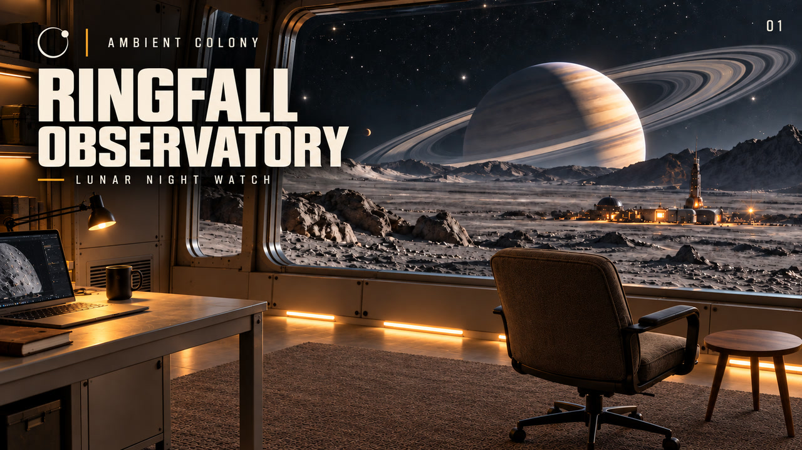
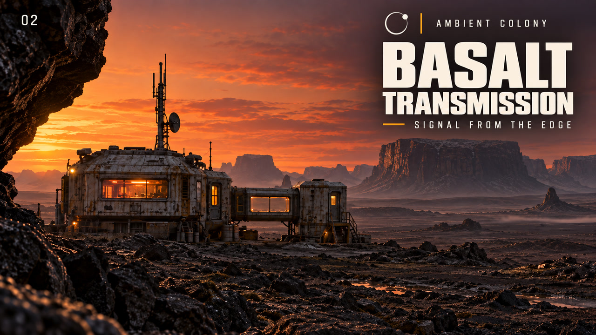
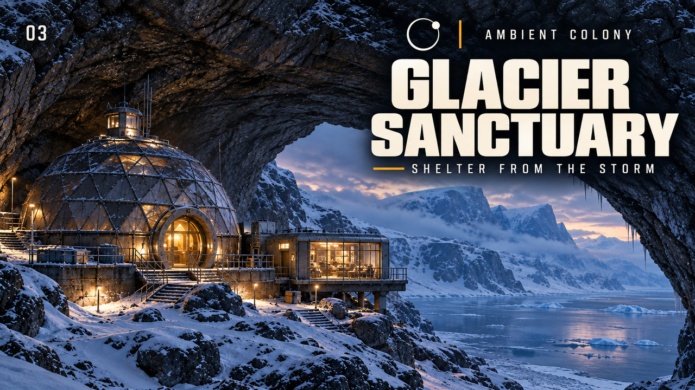

# Ambient Colony - final exports

Catalog #15 is [Beneath a Crimson Sky](15-beneath-a-crimson-sky/README.md), the Skies of Baal project. [Cyberpunk Apartment](16-cyberpunk-apartment/README.md) moves to #16 with its existing V3 loop and soundtrack prompt drafts.

Planning and next actions: [production pipeline and release tracker](../PRODUCTION_PIPELINE.md). This separates completed assets from remaining motion, music, assembly, review and backup work.

Three original approved video packages (01-03), Floodplain (04) with an accepted animation look and verified one-hour 4K Colony export, Saltline (05) with an accepted v5 look and technically verified two-hour 4K Colony export awaiting combined review, and accepted clean artwork for 06-07 with new thumbnails pending review. Packages 08-10 have selected artwork, thumbnails pending review, metadata and music prompts. Packages 11-14 have user-approved artwork/thumbnail packages (2026-09-29), metadata and music/motion briefs. Number 06 now has an accepted v3 animation look, verified twenty-second 4K master and finished two-hour Colony export awaiting combined review; animations for 07-14 have not been produced. Exact image prompts, provenance and current approval scope are recorded per package.

Packages 04-05 also contain revised text-free `artwork-v2-animation.png` candidates with the stronger thumbnail lighting. Their `animation-prep-v1/` folders contain source-coordinate draft masks, scene plans and production briefs; the 04 preparation is now historical (see its current assembly-v1 package); 05 has the current v7 minute-long delivery in music/saltline-animation-v1. Original selected artwork and thumbnails remain unchanged.

All packages 01-14 include `description.txt` and `youtube-tags.txt` for copying into YouTube Studio. The search-tag list is comma-separated and below 500 characters per video. Read [DESCRIPTION_STYLE.md](DESCRIPTION_STYLE.md) for the shared voice, approved sign-off and metadata conventions.

Channel graphic candidate: [ten-second subscribe overlay v1](channel-assets/subscribe-v1/README.md). Green-screen and transparent exports are local review files until accepted; the source renderer, fonts and production notes are portable.

| Package | Loop | Thumbnail |
| --- | --- | --- |
| [01 - Ringfall Observatory](01-ringfall-observatory/) | [20 seconds, 4K](01-ringfall-observatory/video-4k.mp4) | [JPEG](01-ringfall-observatory/thumbnail-v1.jpg) |
| [02 - Basalt Transmission](02-basalt-transmission/) | [20 seconds, 4K](02-basalt-transmission/video-4k.mp4) | [JPEG](02-basalt-transmission/thumbnail-v1.jpg) |
| [03 - Glacier Sanctuary](03-glacier-sanctuary/) | [60 seconds, 4K](03-glacier-sanctuary/video-4k.mp4) | [JPEG](03-glacier-sanctuary/thumbnail-v1.jpg) |
| [04 - Floodplain Keeper](04-floodplain-keeper/) | [20 seconds, 4K](04-floodplain-keeper/video-4k-v2.mp4); [one-hour export](04-floodplain-keeper/assembly-v1/README.md) | [JPEG](04-floodplain-keeper/thumbnail-v1.jpg) |
| [05 - Saltline Receiver](05-saltline-receiver/) | [60 seconds, 4K v7](05-saltline-receiver/video-4k-v7-60s.mp4); [two-hour export](05-saltline-receiver/assembly-v1/README.md) | [JPEG](05-saltline-receiver/thumbnail-v1.jpg) |
| [06 - The Last Cable Station](06-last-cable-station/) | [Final edit v3](06-last-cable-station/artwork-v3-final.png); no video yet | [JPEG](06-last-cable-station/thumbnail-v1.jpg) |
| [07 - Icebound Weather Post](07-icebound-weather-post/) | [Final edit v3](07-icebound-weather-post/artwork-v3-final.png); no video yet | [JPEG](07-icebound-weather-post/thumbnail-v1.jpg) |
| [08 - Rainline Relay](08-rainline-relay/) | [Selected artwork](08-rainline-relay/artwork-v1.png); no video yet | [JPEG](08-rainline-relay/thumbnail-v1.jpg) |
| [09 - The Shoreless Colony](09-offshore-night-office/) | [Selected artwork](09-offshore-night-office/artwork-v1.png); no video yet | [JPEG](09-offshore-night-office/thumbnail-v2.jpg) |
| [10 - Farpoint Station](10-nightward-station/) | [Selected artwork](10-nightward-station/artwork-v3-close-world-leds.png); no video yet | [JPEG](10-nightward-station/thumbnail-v2.jpg) |
| [11 - The Empty Junction](11-empty-junction/) | [Selected v2 artwork](11-empty-junction/artwork-v2.png); no video yet | [JPEG](11-empty-junction/thumbnail-v1.jpg) |
| [12 - Deepwell Station](12-deepwell-station/) | [Selected v2 artwork](12-deepwell-station/artwork-v2.png); no video yet | [JPEG](12-deepwell-station/thumbnail-v1.jpg) |
| [13 - Below the Snowline](13-below-the-snowline/) | [Current v5 artwork](13-below-the-snowline/ice-planet-retheme-v3/artwork-v5.png); [v2 animation](../music/below-the-snowline-animation-v2/README.md); [approved9min music](../music/below-the-snowline-production-2026-11-01/paired-loop-v1/README.md) | [Latest candidate](../music/below-the-snowline-animation-v2/thumbnail-v2.jpg), review pending; [earlier approved JPEG](13-below-the-snowline/thumbnail-v1.jpg) |
| [14 - Crater Rim Survey](14-crater-rim-survey/) | [V5 final-round minute and normal-size comparison](../music/crater-rim-animation-v5/README.md), user review pending | [JPEG](14-crater-rim-survey/thumbnail-v1.jpg) |
| [15 - Beneath a Crimson Sky](15-beneath-a-crimson-sky/) | [60-second synced storm with sound](../music/beneath-a-crimson-sky-synced-storm/skies-of-baal-synced-storm-60s.mp4) | [Skies of Baal draft](15-beneath-a-crimson-sky/thumbnail-warhammer-v1.jpg) |
| [16 - Cyberpunk Apartment](16-cyberpunk-apartment/) | [V4 full-minute 720p/60fps first draft](../music/cyberpunk-apartment-animation-v4/README.md), visual review pending; V3 master retained | Pending |
| [17 - The Gate Camp After Sunset](17-gate-camp/) | [V3 full-minute 720p/30fps first draft](../music/gate-camp-animation-v3/README.md), visual review pending | [The Way Home draft](../creative/brainstorm/2026-10-27-three-worlds/e1-gate-camp/thumbnail-v1.jpg) |
| [18 - Back Before Dawn](18-back-before-dawn/) | [120-second 720p/30fps first draft](../music/back-before-dawn-animation-v1/README.md), visual review pending | [Back Before Dawn draft](../creative/brainstorm/2026-10-27-retro-worlds/h1-workshop/thumbnail-v1.jpg) |

Production masters and draft reviews have different resolutions and frame rates; use each linked delivery record. Scenes 16/17 currently have silent 720p review minutes, not new 4K masters. Long music-video exports are tracked separately through each assembly package and the local inventory. Approved copied media retain their original production paths.

Read [THUMBNAIL_STYLE.md](THUMBNAIL_STYLE.md) before producing the next thumbnail. The user approved this set on 2026-09-25: "man they look awesome". PNGs are the generated masters; JPEGs are 1280x720 exports. `catalog.json` indexes the packages.

After cloning, fetch only the exact media paths required by the scene's resume guide; see [on-demand storage](../EXPORTS.md#download-only-the-scene-you-need). Video paths use exact LFS rules. Requested review checkpoints are backed up explicitly; caches, unselected intermediates and long repeated exports remain local. Compare package manifests and post-push verification receipts for the actual backup scope.

Long upload videos and soundtrack repeats now live in the ignored `../exports/` folder. See [storage policy](../EXPORTS.md) and [local inventory](local-export-inventory.json). The short tracked masters listed above stay here.

Packages 04-14 also contain suggested `youtube-title.txt` and `music/` with one-minute test prompts, longer-piece prompts and manual generation/listening instructions. Floodplain now has a delivered one-hour soundtrack and assembled video; other preparation-only scenes retain their own pending audio status.

Release numbering 11-14 maps to creative concepts 17-20 respectively: The Empty Junction, Deepwell Station, Below the Snowline and Crater Rim Survey. Creative IDs are permanent provenance paths, not public catalog numbers. The original motion briefs record the proposals; the [production tracker](../PRODUCTION_PIPELINE.md) records the latest previews and renders.
